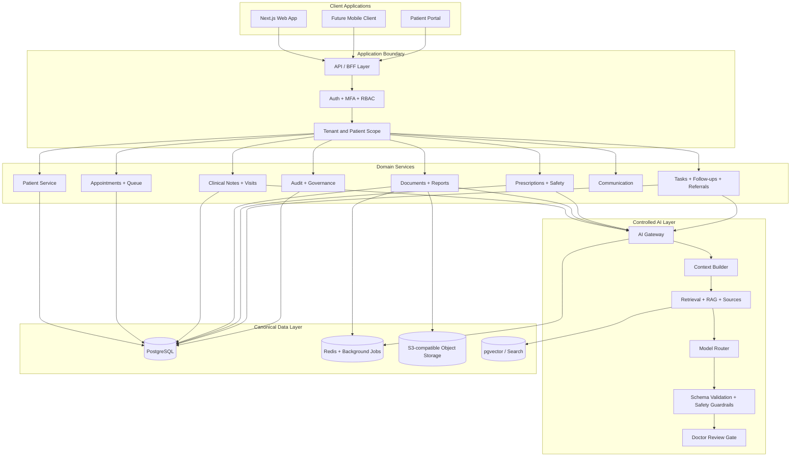
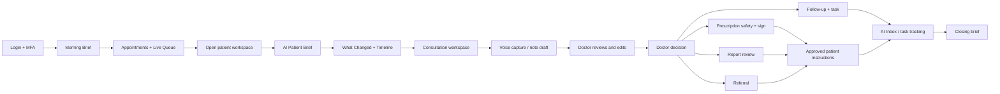
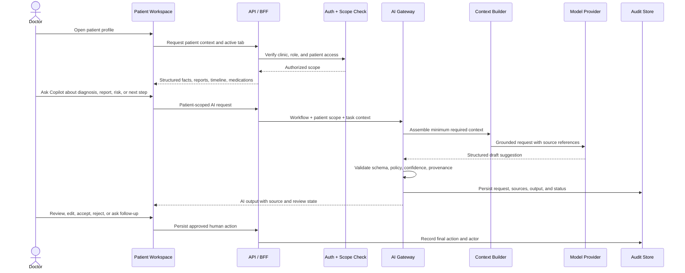
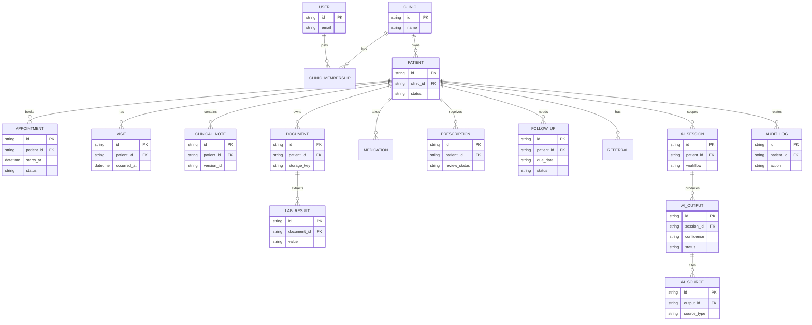

# AI UPCHAR Architecture

**Status:** Product and architecture baseline  
**Audience:** Product, frontend, backend, AI, security, and clinical operations teams  
**Last updated:** 2026-09-10

Patient-interview implementation details and the ongoing change log are maintained in [`PATIENT_INTERVIEW_CHANGELOG.md`](./PATIENT_INTERVIEW_CHANGELOG.md).

## 1. Product Definition

AI UPCHAR is a clinician-controlled operating layer for doctor-led clinics. It brings patient context, consultation documentation, reports, prescription safety, communication, and follow-up work into one longitudinal workspace.

> **AI assists. Doctors decide. Structured clinical data remains the source of truth.**

The system is not an autonomous diagnostic or prescribing product. AI may retrieve context, summarize, compare, classify, draft, suggest, flag, and track, but clinically meaningful actions require an authorized human review or approval.

## 2. Scope

### In scope

- Doctor dashboard with morning brief, queue, priority work, and daily metrics
- Patient search and longitudinal patient workspace
- Consultation notes and voice-to-structured-note workflow
- Report upload, extraction, comparison, and review state
- Prescription builder with safety checks and explicit sign-off
- AI Clinical Copilot scoped to the selected patient and workflow
- AI Inbox, follow-ups, referrals, tasks, and approved communication
- Clinic roles, permissions, audit trail, and governance controls
- Patient portal foundations and consent-aware sharing

### Explicitly out of scope for the first release

- Autonomous diagnosis, prescribing, or prescription signing
- Full hospital ERP functionality
- Unreviewed clinical advice sent directly to patients
- Large microservice decomposition before scale requires it
- Custom LLM training as a launch prerequisite

## 3. Core Principles

1. **Doctor in the loop:** clinical actions require explicit authorized user action.
2. **Source-of-truth separation:** structured clinical records outrank documents, notes, workflow state, AI output, and temporary model context.
3. **Context before intelligence:** every AI request receives only the patient, role, visit, and task context required for that workflow.
4. **Provenance by default:** AI output exposes source documents, facts, confidence, and review state where practical.
5. **Least privilege:** every request is checked against tenant, clinic, role, and patient scope.
6. **Longitudinal thinking:** timelines are generated from structured events, not one untraceable text blob.
7. **Workflow-native AI:** assistance appears inside the patient, report, prescription, inbox, and follow-up workflows.
8. **Auditability:** meaningful AI outputs and clinical actions are immutable, attributable, and reviewable.

## 4. User Roles

| Role | Primary responsibilities | Access boundary |
| --- | --- | --- |
| Doctor | Consult, decide, document, prescribe, review AI output | Authorized clinical patients and assigned clinic |
| Reception | Register, schedule, check in, manage queue | Demographics, appointments, approved communication |
| Care staff | Close tasks, referrals, follow-ups, messages | Assigned workflow items; no unrestricted clinical signing |
| Clinic admin | Staff, permissions, settings, analytics, audit, billing | Clinic-wide operations; no implicit clinical authority |
| Patient | Appointments, prescriptions, reports, instructions, consent | Own records and consent-controlled sharing |

## 5. System Architecture



### Recommended implementation shape

Start as a **modular monolith** with explicit domain boundaries. Keep long-running extraction, indexing, notification, and AI workloads asynchronous. Split services only when deployment scale, reliability, or ownership requires it.

Recommended production stack:

- Frontend: Next.js + TypeScript + Tailwind + component system
- Server state: React Query or an equivalent typed data layer
- Backend: FastAPI + Python
- Contracts: Pydantic schemas and generated TypeScript types
- Database: PostgreSQL with migrations
- Jobs: Celery or equivalent workers with Redis
- Files: S3-compatible object storage with short-lived signed URLs
- Retrieval: pgvector initially, isolated behind a retrieval interface
- Deployment: Docker on a managed platform first; Kubernetes later if justified

## 6. End-to-End Clinic Flow



### Pre-visit

- Morning Brief summarizes today's workload and priority items.
- Queue shows check-in, readiness, wait time, and next patient.
- Patient search opens the correct chart quickly.
- AI Patient Brief provides a source-linked context snapshot.

### During the visit

- Patient identity, conditions, medications, reports, and recent events remain visible.
- Voice capture can create a structured note draft.
- Copilot can compare reports, surface missing information, and explain workflow options.
- The doctor reviews and edits all AI-derived content before saving or acting.

### After the visit

- Prescription safety checks run before explicit sign-off.
- Reports, referrals, follow-ups, and instructions remain linked to the visit.
- Patient-facing communication is approved under clinic policy.
- Outstanding work returns to the inbox and task engine.

## 7. Patient-Scoped AI Copilot Flow



The current frontend demo implements the interaction locally. A production Copilot must route through an authenticated AI Gateway and must never receive direct access to the canonical database.

## 8. AI Output Contract

Every AI result should carry a typed envelope similar to:

```ts
type AIOutput<T> = {
  id: string;
  patientId: string;
  workflow: "brief" | "note" | "report" | "prescription" | "inbox" | "research";
  label: "FACT" | "DERIVED" | "AI_GENERATED" | "DOCTOR_AUTHORED" | "SYSTEM_STATE";
  content: T;
  confidence: "high" | "moderate" | "low" | "blocked";
  sourceIds: string[];
  modelVersion?: string;
  promptVersion?: string;
  status: "generated" | "reviewed" | "edited" | "accepted" | "rejected";
  createdAt: string;
  reviewedBy?: string;
  reviewedAt?: string;
};
```

### Confidence behavior

- **High:** strong source grounding or deterministic validated extraction.
- **Moderate:** useful synthesis requiring clinician review.
- **Low:** ambiguous or incomplete evidence; never present as a clinical fact.
- **Blocked:** policy, authorization, validation, or safety failure; suppress the action.

## 9. Clinical Safety Gates

AI must not:

- silently diagnose;
- independently prescribe or sign a prescription;
- silently modify a clinical record;
- send clinical advice without authorized review;
- bypass clinic or patient authorization;
- present unsupported inference as fact.

| Action | AI may prepare | Authorized human must do |
| --- | --- | --- |
| Clinical note | Draft and structure | Review, edit, and save |
| Prescription | Suggest and safety-check | Review and explicitly sign |
| Patient message | Draft | Review and authorize |
| Referral | Draft package | Approve and share |
| Record change | Suggest correction or new version | Approve persisted version |
| Clinical consideration | Surface context | Interpret and decide |

## 10. Data Architecture



### Canonical hierarchy

`Structured clinical data > validated source documents > doctor-authored notes > approved workflow state > AI-generated assistance > temporary model context`

Patient timelines should be generated from events with type, timestamp, author/source, patient, visit linkage, provenance, and status. Do not store the whole longitudinal record as one generated text blob.

## 11. API Surface

Base path: `/api/v1`

- `/auth`, `/me`, `/clinics`
- `/patients`, `/appointments`, `/queue`, `/visits`
- `/notes`, `/ai/voice`, `/ai/patient-summary`, `/ai/what-changed`
- `/documents`, `/reports`, `/prescriptions`
- `/followups`, `/inbox`, `/referrals`
- `/briefs/morning`, `/briefs/closing`
- `/ai/gateway`, `/analytics`, `/admin`

API rules:

- Use consistent success and error envelopes.
- Paginate collection endpoints.
- Use idempotency keys for retryable create/action operations.
- Enforce clinic and patient scope on every protected operation.
- Rate-limit AI endpoints.
- Validate AI input/output with typed schemas.
- Include correlation IDs and audit events for meaningful actions.

## 12. Current Frontend Mapping

| Area | Current implementation |
| --- | --- |
| Landing page | `app/page.tsx` and marketing section components |
| Interactive AI explanation | `components/InteractiveEngineSection.tsx` |
| Doctor workspace | `components/DoctorWorkspace.tsx` |
| Patient-scoped Copilot demo | `components/DoctorWorkspace.tsx` |
| Demo route | `app/demo/page.tsx` |
| Gemini concept preview | `app/gemini-preview/page.tsx` and `components/GeminiPreview.tsx` |
| Shared styling | `app/globals.css`, Tailwind config |

The current frontend uses illustrative local state. It is a prototype surface, not a clinical production system until authentication, APIs, database persistence, audit logging, and safety services are connected.

## 13. Background Jobs and Integrations

| Job | Trigger | Output |
| --- | --- | --- |
| Report extraction | Document upload | Classified document and structured values |
| AI summary | Patient/report request | Source-linked summary with confidence |
| Embedding update | Approved document or note | Searchable patient/knowledge chunks |
| Morning brief | Scheduled clinic job | Today's workload and priorities |
| Reminder delivery | Due/overdue follow-up | Notification or approved message task |
| Referral check | Referral status change | Missing consent/document/task alert |
| Analytics aggregation | Periodic schedule | Clinic performance metrics |

Integrations should be isolated behind adapters: ABDM/ABHA consent-aware exchange, lab providers, payments, messaging providers, identity/SSO, and trusted knowledge sources.

## 14. Non-functional Requirements

- **Security:** TLS, encryption at rest where supported, MFA, RBAC, tenant isolation, signed file URLs.
- **Privacy:** data minimization, purpose-bound consent, retention policy, patient-scope checks.
- **Audit:** immutable history for AI outputs, reviews, edits, signatures, and sharing.
- **Reliability:** backups, retry strategy, idempotent jobs, disaster recovery plan.
- **Performance:** fast patient search, dashboard load, queue refresh, and patient navigation.
- **Availability:** graceful degradation when AI or external integrations are unavailable.
- **Observability:** logs, metrics, traces, AI latency/cost/error telemetry, correlation IDs.
- **Maintainability:** typed APIs, migrations, automated tests, documented domain boundaries.

## 15. Delivery Roadmap

### MVP / P0

1. Authentication, clinic tenancy, roles, and audit foundation
2. Patient registration, search, appointments, and queue
3. Patient workspace, timeline, visits, notes, and vitals
4. Prescription builder, safety checks, review/sign, and audit
5. Documents, reports, object storage, and extraction state
6. AI Gateway, context builder, schemas, provenance, and policy checks
7. Patient Brief, Voice Notes, and Report Intelligence

### P1

- What Changed
- AI Inbox and workflow classification
- Patient communication and approved instructions
- Referrals and consent tracking
- Morning/Closing Briefs
- Knowledge assistant and trusted RAG
- Follow-up intelligence and document generation

### P2

- Population health and chronic disease workflows
- Insurance and prior authorization
- Billing depth and payments
- Telemedicine
- ABDM integration
- Patient app, devices, wearables, and advanced analytics

## 16. Key Risks and Mitigations

| Risk | Mitigation |
| --- | --- |
| Unsafe or hallucinated AI output | Grounding, schemas, provenance, confidence, policy checks, human gates |
| Poor data quality | Structured source of truth, validation, missing-data indicators |
| Workflow mismatch | Observe real clinics, prototype with doctors, measure clicks and completion |
| Overbuilding | Modular monolith, explicit MVP boundaries, asynchronous heavy work |
| Privacy/security incident | RBAC, tenant isolation, MFA, encryption, audit, security testing |
| AI latency and cost | Model routing, caching, smaller models where safe, async jobs |
| Vendor lock-in | AI Gateway abstraction and standardized output contracts |

## 17. Success Metrics

- Time from patient open to useful context
- Consultation note completion time
- Follow-up and report review completion
- Prescription safety alerts reviewed
- AI acceptance, edit, rejection, and source click-through rate
- AI latency, extraction failure, and job failure rate
- Daily active doctors and consultations using AI
- Queue delay and unresolved task backlog

The product wins when doctors spend less effort assembling information and documenting routine work while retaining explicit clinical control and a trustworthy record of what happened.
