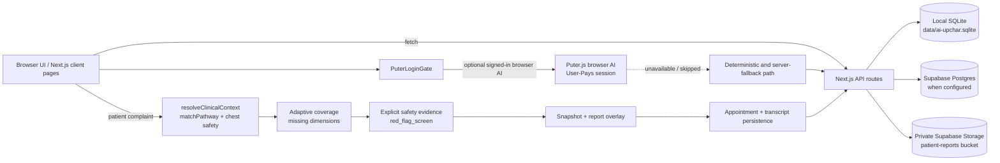

# AI UPCHAR

AI UPCHAR is a clinician-controlled workspace for patient context, clinical documentation, reports, prescription safety, AI assistance, and follow-up workflows. The product principle is **AI assists. Doctors decide.** Structured clinical data remains the source of truth, and AI-generated content is review-required.

## Current status / recent delivery

**Documentation date:** 2026-09-14
**Committed delivery covered here:** 2026-09-12 through 2026-09-14

The following work is committed repository history, grouped by workstream. This is not a claim that every production-hardening item is complete.

### Platform, data, and AI

- **`71820d0`** — migrated the data layer toward Supabase Postgres and added Puter.js client-side AI across the API/client boundary.
- **`4c7ce52`** — delivered real browser-side AI and patient-report intelligence: Puter client/types/prompts, report upload and storage, signed URLs, GPT-4o + Gemini vision findings, report-driven adaptive questions, and the doctor-facing pre-visit report path.
- **`f84e510`** — combined the Puter login gate with an optional degraded mode so the workflow can continue when browser AI is unavailable.
- **`646e190`** — added the server-side AI/hybrid intake state-machine foundation and AI endpoints. Server AI remains an optional path; the browser User-Pays path is the primary cost-safe demo path.

### Patient intake and appointment preparation

- **`d1dca7d`** — added the conversational appointment flow, internet research, training-data capture, and pre-visit report preparation.
- **`341cf36`** — guaranteed non-empty bilingual appointment questions, added the greeting, AI adaptive follow-ups, and question logging.
- **`d6a73a4`** — moved Puter sign-in to the beginning of the appointment flow so AI is connected before questioning starts.
- **`03165a0`** — added complaint-specific deep questioning with the reasoning model and a complaint-aware fallback.
- **`2392465`** — added research-informed history/question planning and a section-wise doctor report. This is structured history and report assistance, not autonomous diagnosis.
- **`f855511`** — added duplicate-question prevention, firmer handling of an AI `STOP`, and a double-submit processing lock.
- **`42bd3fa`** — added per-appointment chat history, past-visit context for AI, and a printable prescription surface.

The appointment flow is adaptive rather than a universal questionnaire:

1. A fixed script captures identity, phone, new/returning status, basic demographics, appointment date/time, and the chief complaint.
2. The complaint is resolved against the curated clinical context. A matched pathway supplies reviewed questions and safety signals; an unmatched complaint can use the research/AI plan and deterministic complaint-aware fallback.
3. The dynamic deep phase asks one new complaint-specific question at a time. It records question/answer metadata and uses coverage to skip dimensions already supported by the patient's own answers.
4. Research and report preparation are best-effort. The collected snapshot and deterministic safety overlay remain available if an external AI/research call fails.
5. Finalization prepares the doctor-facing snapshot/report, saves the pre-visit record, creates the appointment, saves the transcript, and shows the success state.

There is no universal questionnaire and no fixed clinical question count. The current `MAX_DEEP` value is a ceiling for ordinary dynamic questioning; adaptive coverage and the safety state determine what remains unresolved. Reaching the ceiling with unresolved safety is surfaced for clinician review rather than presented as a safely completed screen.

### Clinical pathways and safety

- **`bc1c48f`** — added the Phase-1 clinical pathway library and explainable general/pathway red-flag engine in `lib/clinicalPathways.ts`.
- **`8ebfb94`** — added additive chest-pain safety context/resolution, source-aware explicit safety-screen evidence, adaptive fallback, the exact eight-phrase regressions, non-chest regressions, and `MAX_DEEP` unresolved-safety handling.

The safety design is deliberately additive and non-diagnostic:

- `matchPathway(complaint, extra?)` remains the compatible curated matcher.
- `assessChestSafety()` detects a bounded location/quality combination such as chest/seene plus pain, pressure, heaviness, burning, or tightness; standalone words do not create a chest route.
- `resolveClinicalContext()` combines the ordinary pathway with the optional chest safety profile and returns `curated_pathway`, `chest_safety_fallback`, or `generic_fallback`.
- `pathwayForClinicalContext()` reuses the reviewed `chest_pain` pathway for chest safety questions without duplicating its clinical meanings.
- Complaint text can surface an explainable red-flag signal for clinician visibility, but it never satisfies `red_flag_screen` by itself. Only source-attributed, targeted safety evidence (`patient_answer`, `structured_safety_answer`, or clinician input with the appropriate question dimension) can complete that screen.
- Emergency/urgent signal values and emergency-first ordering are preserved. AI output cannot lower a deterministic urgency signal.
- Missing, ambiguous, or contradictory safety evidence remains unresolved. At `MAX_DEEP`, the final report carries a clinician-review limitation instead of claiming a safe negative screen.

These rules preserve the distinction between **recognizing a safety-relevant complaint**, **detecting an explainable signal**, and **confirming that the patient answered the danger-sign screen**. None of them diagnoses or treats a condition.

### Doctor workspace, inventory, and shared state

- **`170a8af`** — delivered the clinic workflow workspace with dashboard, appointments, patients, inventory, billing, queue, inbox, and follow-up surfaces.
- **`96ae41e`** — added the inventory catalogue, purchase price, stock ledger, and billing/inventory API and UI updates.
- **`d5948fa`** — added prescription inventory UX and workspace routing with a Redux store/provider.
- **`b0378d4`** — added typed Redux workspace state/hooks, the state audit, and URL query synchronization.

Redux is intentionally narrow. `workspace.activeNav` and `workspace.selectedPatientId` are cross-workspace coordination state. Appointment conversation answers, uploads, report findings, prescription drafts, API responses, and other sensitive clinical data remain local to their workflow or owned by API persistence. See [docs/redux-state-audit.md](docs/redux-state-audit.md).

### Clinical Report Renderer and verification

- **`11aec8c`** — delivered the reusable Clinical Report Renderer pipeline: parser diagnostics and semantic state, typed intermediate representation (IR), renderer, safe links, accessibility behavior, browser verification, semantic/state tests, and test-only host-equivalence coverage.

The renderer is a presentation boundary, not a clinical reasoning system:

```text
raw report + explicit metadata/state
        -> parser diagnostics + semantic state
        -> typed ClinicalReportIR
        -> accessible ClinicalReportRenderer
        -> host surface
```

The parser preserves source wording, order, citations, sources, links, and explicit priority metadata. The renderer consumes the IR and applies human-readable layout. `empty`, `error`, `fallback`, and `ready` states remain distinct. Warning/urgent presentation requires explicit structure or metadata; ordinary alarming keywords, bold, or emphasis do not invent a clinical classification. Validation covers semantic behavior, safe links, accessibility, browser behavior, and primary/second-host equivalence.

### Worktree status: pre-existing, uncommitted files

The current worktree also contains changes that are **not part of the committed delivery list above** and are not treated as released functionality here:

- Modified: `components/Header.tsx`, `tsconfig.tsbuildinfo`.
- Untracked: `.kiro/specs/appointment-patient-identity-adaptive-intake/`, `components/DatePicker.tsx`, `components/PatientAutocomplete.tsx`, `components/ReduxProvider.tsx`, `components/TimeSelect.tsx`, `lib/workspaceApi.ts`, `scripts/appointment-bug-condition-exploration.mjs`, `scripts/appointment-bug-condition-fixed-regression.mjs`, `scripts/appointment-task-3-4-contracts.mjs`, `scripts/appointment-task-3-5-contracts.mjs`, `scripts/appointment-task-3-6-tests.mjs`, `scripts/appointment-task-3-7-tests.mjs`, `scripts/audit-frontend-api.mjs`, `scripts/clinical-pathways-task-3-3-tests.mjs`, `scripts/preservation-property-tests.mjs`, and `test-results/`.

This documentation update changes only `README.md` and `docs/PROJECT_STATUS.md`; it does not absorb, validate, or modify those worktree files.

## Public routes

### Marketing and product

- `/` - home and product overview (`app/page.tsx`)
- `/product` - product and AI capabilities (`app/product/page.tsx`)
- `/workflow` - connected clinical workflow (`app/workflow/page.tsx`)
- `/for-doctors` - doctor experience (`app/for-doctors/page.tsx`)
- `/security` - safety, privacy, and governance (`app/security/page.tsx`)
- `/about` - about AI UPCHAR (`app/about/page.tsx`)
- `/contact` - clinic demo and contact form (`app/contact/page.tsx`)
- `/demo` - interactive doctor workspace demo (`app/demo/page.tsx`)
- `/gemini-preview` - isolated Gemini concept preview (`app/gemini-preview/page.tsx`)

### Doctor, patient, reception, and admin

- `/doctor/morning-brief` - morning brief
- `/doctor/queue` - live queue
- `/doctor/inbox` - AI inbox
- `/doctor/follow-ups` - follow-up work
- `/patient/portal` - patient portal
- `/patient/book` - existing multi-step booking flow
- `/patient/appointment` - conversational appointment and adaptive intake flow
- `/patient/intake` - smart intake/report upload flow
- `/reception/checkin` - reception check-in
- `/admin/analytics` - admin analytics

## Stack

- Next.js 14 App Router
- React 18
- TypeScript
- Tailwind CSS
- lucide-react icons
- SQLite via `better-sqlite3` for local/demo persistence
- Supabase/Postgres and Supabase Storage integration paths
- Puter.js browser AI with optional server-side Puter-compatible fallback

## Getting started

```bash
npm install
npm run dev
```

Open `http://localhost:3000`.

For Supabase-backed persistence, copy `.env.example` to `.env.local`, configure the server-only values, and apply the schema/seed path described below. Never expose `SUPABASE_SERVICE_ROLE_KEY`, `DATABASE_URL`, or `PUTER_API_TOKEN` to browser code.

## Product principles

1. **AI assists. Doctors decide.** AI output is a draft, consideration, transcription, classification, or safety signal for review; it is not autonomous clinical action.
2. **Explicit approval.** Prescription signing, clinical record changes, referrals, and patient-facing clinical communication require an authorized human workflow.
3. **Source provenance.** Reports and AI output retain source context, visible limitations, and review-required language where available.
4. **Patient safety first.** Deterministic pathway/general red flags remain visible and are not lowered by an AI response.
5. **Privacy by design.** Report files use private storage and short-lived signed links when Supabase Storage is configured.
6. **Graceful degradation.** Browser AI, server AI, research, and report enrichment are optional; fixed intake and deterministic fallback paths remain available.
7. **No diagnosis by presentation.** Pathway matching, report rendering, red flags, and urgency are support and review mechanisms, not diagnostic or treatment decisions.

## Current implementation architecture

The following is the current modular-monolith/demo architecture. It is not the future service topology in [docs/ARCHITECTURE.md](docs/ARCHITECTURE.md); that document is a recommended target for production hardening, not a statement that authentication, tenancy, jobs, or the AI Gateway are already complete.



### AI and degraded mode

`lib/puterClient.ts` calls browser-side Puter.js models after the optional login gate. The browser path uses the end user's Puter session (User-Pays) rather than putting a model key in the application. `lib/clientPrompts.ts` builds the browser-safe prompts for copilot, symptom support, scribe drafts, report vision, adaptive follow-ups, research, and pre-visit report preparation. `app/api/_lib/ai.ts` and `app/api/_lib/prompts.ts` provide server route support when the server environment is configured.

If Puter is unavailable, skipped, or times out, the appointment flow still has guaranteed bilingual base questions, deterministic pathway questions, adaptive coverage, red-flag detection, and a report fallback. Internet research, AI phrasing, and AI report enrichment are best-effort. The browser smoke/degraded-mode check is separate from the pure-library and renderer command results below because external Puter availability is not deterministic.

### Appointment data flow

```text
fixed identity + scheduling capture
  -> complaint resolution
  -> curated pathway or research/AI plan
  -> dynamic deep question (one new topic at a time)
  -> adaptive coverage and explicit safety evidence
  -> intake snapshot + deterministic red-flag overlay
  -> pre-visit report save
  -> appointment save
  -> transcript save and success display
```

The fixed script owns identity, phone, new/returning status, basic demographics, date, time, complaint, duration, prior care, and report prompts. The dynamic phase owns complaint-specific history. `coverageFor()` determines which dimensions are satisfied; question generation can be AI-phrased, but `questionForDimension()` is the deterministic safety fallback. The final snapshot is review-required and retains unresolved safety limitations. The appointment API receives the resolved `patientId`; report, brief, transcript, queue, and doctor-facing joins are intended to remain patient-scoped by that ID.

## Current module and path map

The paths below describe the current repository layout used by the committed work. The API list includes all current route handlers, not only the original product-status count.

### App routes and shared app shell

| Route/module | Purpose |
| --- | --- |
| `app/layout.tsx` | Root layout, metadata, and browser Puter script integration |
| `app/globals.css` | Global styles and Tailwind-facing CSS |
| `app/page.tsx` | Home |
| `app/product/page.tsx`, `app/workflow/page.tsx`, `app/for-doctors/page.tsx` | Marketing/product workflow pages |
| `app/security/page.tsx`, `app/about/page.tsx`, `app/contact/page.tsx` | Security, about, and contact pages |
| `app/demo/page.tsx` | Doctor workspace demo boundary |
| `app/gemini-preview/page.tsx` | Isolated Gemini concept preview |
| `app/patient/appointment/page.tsx` | Conversational appointment, report upload, adaptive intake, research, and finalization |
| `app/patient/book/page.tsx` | Multi-step patient booking |
| `app/patient/intake/page.tsx` | Smart intake and report upload |
| `app/patient/portal/page.tsx` | Patient portal |
| `app/doctor/morning-brief/page.tsx` | Doctor morning brief |
| `app/doctor/queue/page.tsx` | Doctor queue |
| `app/doctor/inbox/page.tsx` | Doctor AI inbox |
| `app/doctor/follow-ups/page.tsx` | Doctor follow-up work |
| `app/reception/checkin/page.tsx` | Reception check-in |
| `app/admin/analytics/page.tsx` | Admin analytics |

### API route handlers

| API path | Current handler |
| --- | --- |
| `/api/ai-training` | `app/api/ai-training/route.ts` |
| `/api/analytics` | `app/api/analytics/route.ts` |
| `/api/appointments` | `app/api/appointments/route.ts` |
| `/api/appointments/chat` | `app/api/appointments/chat/route.ts` |
| `/api/billing` | `app/api/billing/route.ts` |
| `/api/briefs/morning` | `app/api/briefs/morning/route.ts` |
| `/api/communications` | `app/api/communications/route.ts` |
| `/api/copilot` | `app/api/copilot/route.ts` |
| `/api/follow-ups` | `app/api/follow-ups/route.ts` |
| `/api/inbox` | `app/api/inbox/route.ts` |
| `/api/insights` | `app/api/insights/route.ts` |
| `/api/intake` | `app/api/intake/route.ts` |
| `/api/intake/next` | `app/api/intake/next/route.ts` |
| `/api/inventory` | `app/api/inventory/route.ts` |
| `/api/medical-records/analyze` | `app/api/medical-records/analyze/route.ts` |
| `/api/medical-records/reports` | `app/api/medical-records/reports/route.ts` |
| `/api/medical-records/summarize` | `app/api/medical-records/summarize/route.ts` |
| `/api/patients` | `app/api/patients/route.ts` |
| `/api/patients/context` | `app/api/patients/context/route.ts` |
| `/api/pre-visit` | `app/api/pre-visit/route.ts` |
| `/api/pre-visit/summary` | `app/api/pre-visit/summary/route.ts` |
| `/api/prescriptions` | `app/api/prescriptions/route.ts` |
| `/api/profile/settings` | `app/api/profile/settings/route.ts` |
| `/api/queue` | `app/api/queue/route.ts` |
| `/api/referrals` | `app/api/referrals/route.ts` |
| `/api/reports/upload` | `app/api/reports/upload/route.ts` |
| `/api/scribe` | `app/api/scribe/route.ts` |
| `/api/sessions` | `app/api/sessions/route.ts` |
| `/api/symptom-analysis` | `app/api/symptom-analysis/route.ts` |
| `/api/workspace/actions` | `app/api/workspace/actions/route.ts` |
| `/api/workspace/summary` | `app/api/workspace/summary/route.ts` |

Shared server helpers are in `app/api/_lib/ai.ts`, `app/api/_lib/database.ts`, `app/api/_lib/demo.ts`, `app/api/_lib/inventory.ts`, `app/api/_lib/prompts.ts`, `app/api/_lib/seedCatalogue.ts`, and `app/api/_lib/storage.ts`.

### Browser AI, prompts, pathways, and renderer

| Area | Current modules |
| --- | --- |
| Browser AI | `lib/puterClient.ts`, `lib/puter.d.ts`, `components/PuterLoginGate.tsx`, `lib/usePuterAuth.ts` |
| Browser prompt and report contracts | `lib/clientPrompts.ts`, `lib/aiTraining.ts` |
| Clinical pathways and safety | `lib/clinicalPathways.ts` |
| Workspace state | `lib/workspaceStore.ts`, `lib/reduxHooks.ts`, `components/WorkspaceReduxProvider.tsx` |
| Workspace API helper | `lib/workspaceApi.ts` (currently present in the pre-existing dirty worktree; not counted as a committed delivery item) |
| Renderer types and parser | `lib/clinical-report-renderer/types.ts`, `lib/clinical-report-renderer/parser.ts`, `lib/clinical-report-renderer/index.ts` |
| Renderer presentation | `components/clinical-report-renderer/ClinicalReportRenderer.tsx`, `components/clinical-report-renderer/clinical-report-renderer.css` |
| Workspace shell | `components/DoctorWorkspace.tsx` |
| Workspace screens | `components/workspace/DashboardScreen.tsx`, `AppointmentsScreen.tsx`, `PatientsScreen.tsx`, `InventoryScreen.tsx`, `BillingScreen.tsx`, `PreVisitBrief.tsx`, `PrescriptionBuilder.tsx`, `PrescriptionLetter.tsx`, `AIResponse.tsx`, `api.ts` |

### Persistence, storage, and schema

- Local/demo database: `data/ai-upchar.sqlite`, accessed through `app/api/_lib/database.ts`; the runtime database is ignored by Git.
- Supabase/Postgres schema and seed: `supabase/schema.sql` and `supabase/seed.sql`; `scripts/gen-pg-schema.mjs`, `scripts/apply-schema.mjs`, `scripts/push-schema.mjs`, and related database scripts support the migration path.
- Supabase Storage helper: `app/api/_lib/storage.ts`. The private bucket is `patient-reports`; accepted files are PNG/JPG/WEBP/PDF up to 20 MB. Report rows retain `storage_path` and `ai_findings`.
- Signed report links: the server uses `SUPABASE_SERVICE_ROLE_KEY` to upload private objects and mint short-lived signed URLs (the current helper defaults to one hour). The bucket is not made public.
- Environment configuration: `.env.example` documents `SUPABASE_URL`, `SUPABASE_SERVICE_ROLE_KEY`, `DATABASE_URL`, and optional `PUTER_API_TOKEN`. `SUPABASE_SERVICE_ROLE_KEY`, `DATABASE_URL`, and `PUTER_API_TOKEN` are server-only values.

This is still a local/demo plus Supabase integration path, not a completed single-database production cutover. Full SQLite-to-Postgres migration, tenant enforcement, authentication, and audit activation remain future work.

### Renderer and validation files

- Pure chest safety harness: `scripts/chest-pain-pathway-matching-tests.mjs`.
- Adaptive appointment harness: `scripts/appointment-adaptive-interview-tests.mjs`.
- Renderer semantic/state harness: `scripts/clinical-report-renderer-semantic-state-tests.mjs`.
- Renderer contract/property harness: `scripts/clinical-report-renderer-contract-tests.mjs`.
- Renderer browser/accessibility/host-equivalence tests: `tests/clinical-report-renderer/browser-verification.spec.ts`, `accessibility.spec.ts`, `host-equivalence.spec.ts`.
- Test-only second host: `tests/clinical-report-renderer/fixtures/second-host/host-adapter.tsx` and its `README.md`.
- The legacy `scripts/clinical-pathways-task-3-3-tests.mjs` is known to be drifted from the current public API and is documented separately as a limitation; it was not changed as part of this documentation update.

## State boundaries and Redux

The doctor workspace Redux store is mounted by `components/WorkspaceReduxProvider.tsx` at the demo boundary. It contains only:

- `workspace.activeNav`, the cross-screen navigation state synchronized with the `screen` query parameter.
- `workspace.selectedPatientId`, the opaque patient selection shared by the shell and patient panels.

Patient demographics, histories, reports, bills, AI summaries, appointment conversation answers, uploads, report findings, prescription drafts, API responses, request status, and other clinical payloads remain local to the owning component or API-owned. This avoids a global sensitive-data cache and avoids stale duplicate server state. The full rationale is in [docs/redux-state-audit.md](docs/redux-state-audit.md).

## Persistence and deployment reality

- **Local/demo:** SQLite is the low-friction demo path at `data/ai-upchar.sqlite`; seed and database helpers live under `app/api/_lib/` and `scripts/`.
- **Supabase/Postgres:** the migration work and schema are present, and API code has Supabase/Postgres integration paths. Configure `SUPABASE_URL`, `SUPABASE_SERVICE_ROLE_KEY`, and `DATABASE_URL` as server values; this is not yet a proof that every production write has completed a single-store cutover.
- **Reports:** `app/api/reports/upload/route.ts` stores report metadata in the database and, when Storage is configured, uploads the original file to the private `patient-reports` bucket. `storage_path` and `ai_findings` are persisted; doctors receive a short-lived signed file URL rather than a public URL.
- **AI:** browser-side Puter.js uses the patient's signed-in Puter session; `PUTER_API_TOKEN` enables optional server-side AI paths. If either AI path is unavailable, the deterministic appointment and safety layers remain the source of workflow continuity.
- **Security reality:** there is no complete application authentication/MFA/RBAC boundary, clinic tenant isolation is not enforced end-to-end, and the audit table exists without full immutable action logging. These are production blockers, not hidden assumptions.

## Future architecture versus current implementation

[docs/ARCHITECTURE.md](docs/ARCHITECTURE.md) describes the recommended production direction: authenticated API/BFF boundaries, tenant and patient scope checks, a modular domain architecture, asynchronous jobs, an AI Gateway, retrieval/provenance, PostgreSQL, object storage, and audit/governance controls. It is a target/recommended architecture. The current repository is a Next.js modular monolith with local/demo persistence, Supabase integration paths, browser AI, direct API routes, and targeted safety/renderer contracts; it does not yet implement every diagrammed service or control.

## Validation commands

Run these as single-run checks from the repository root:

```bash
npm run lint
node node_modules/typescript/bin/tsc --noEmit
npm run build
npm run test:appointment-adaptive-interview
node --experimental-strip-types scripts/chest-pain-pathway-matching-tests.mjs
npm run test:clinical-report-renderer:semantic
npm run test:clinical-report-renderer
```

Current recorded results for the committed work:

- Chest pathway/safety harness: **12/12 checks passed**.
- Adaptive appointment harness: **8/8 checks passed**.
- Renderer semantic/state harness: **10/10 passed**.
- Renderer contract/property harness: **100 iterations per property passed**.
- `npm run lint`, `node node_modules/typescript/bin/tsc --noEmit`, and `npm run build`: passed.
- Browser smoke, renderer accessibility/host-equivalence, and Puter optional/degraded-mode checks are separate from the pure command results. They must be run in a browser environment when validating external Puter availability or browser-engine behavior.
- Known drift: `scripts/clinical-pathways-task-3-3-tests.mjs` targets an older contract and remains drifted; it was not fixed or used to claim current chest-safety success.

## Known limitations / next steps

- Implement real application authentication, MFA, session management, RBAC, and explicit Doctor/Reception/Care staff/Admin/Patient authorization.
- Enforce clinic tenant isolation and patient-scope checks on every protected API operation.
- Activate immutable audit logging for AI outputs, reviews, edits, signatures, sharing, and meaningful clinical actions.
- Complete the SQLite-to-Postgres migration and production deployment/backup/observability plan.
- Integrate real WhatsApp/SMS/email dispatch, voice/telephony intake, vitals devices, consent workflows, ABDM/ABHA, laboratory/pharmacy systems, and payments.
- Treat live Puter availability, browser sign-in, model quotas, and external research as optional dependencies; keep testing degraded mode.
- Expand natural-language coverage only through reviewed pathway anchors and explicit evidence contracts; keyword matching is not a substitute for clinical review.
- Keep clinician review boundaries for all AI reports, scribe drafts, research, red flags, urgency, medication considerations, and patient communications. The system must not autonomously diagnose, prescribe, sign, or send clinical advice.
- Add broader unit, integration, and end-to-end coverage beyond the current targeted harnesses while keeping the legacy clinical-pathways task drift visible.

## Documentation

- [Architecture and system flows](docs/ARCHITECTURE.md)
- [Redux state audit](docs/redux-state-audit.md)
- SQLite persistence is stored locally in `data/ai-upchar.sqlite` and is ignored by Git.
- For hosted persistence, copy `.env.example`, run `supabase/schema.sql` in Supabase SQL Editor, and set `SUPABASE_URL` plus the server-only `SUPABASE_SERVICE_ROLE_KEY` (and `DATABASE_URL` where the Postgres path is used).
- [Interactive doctor workspace](app/demo/page.tsx)
- [Landing page](app/page.tsx)

## Production build

```bash
npm run build
npm start
```
